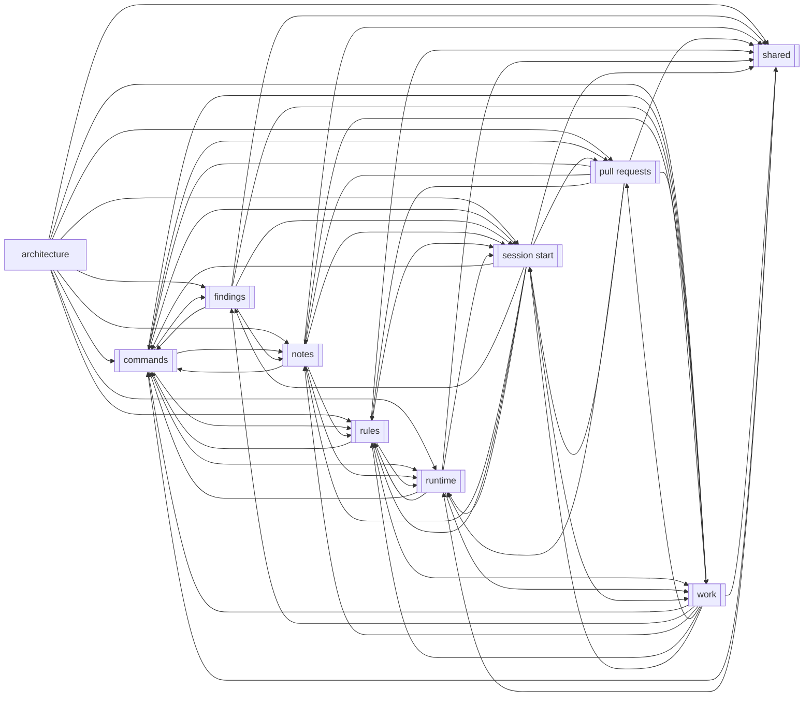
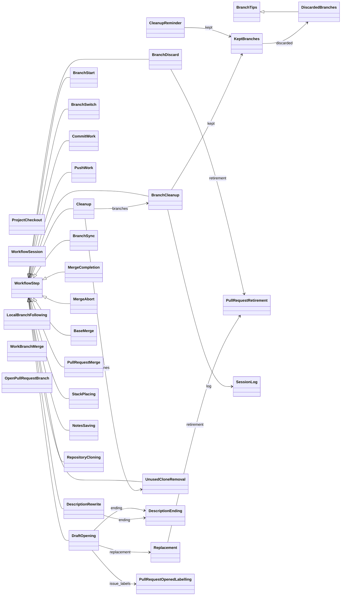
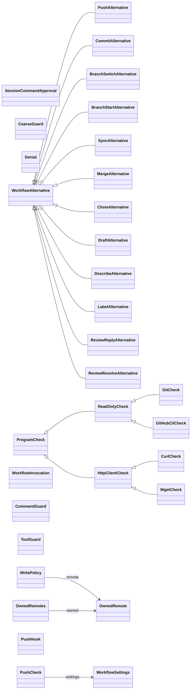
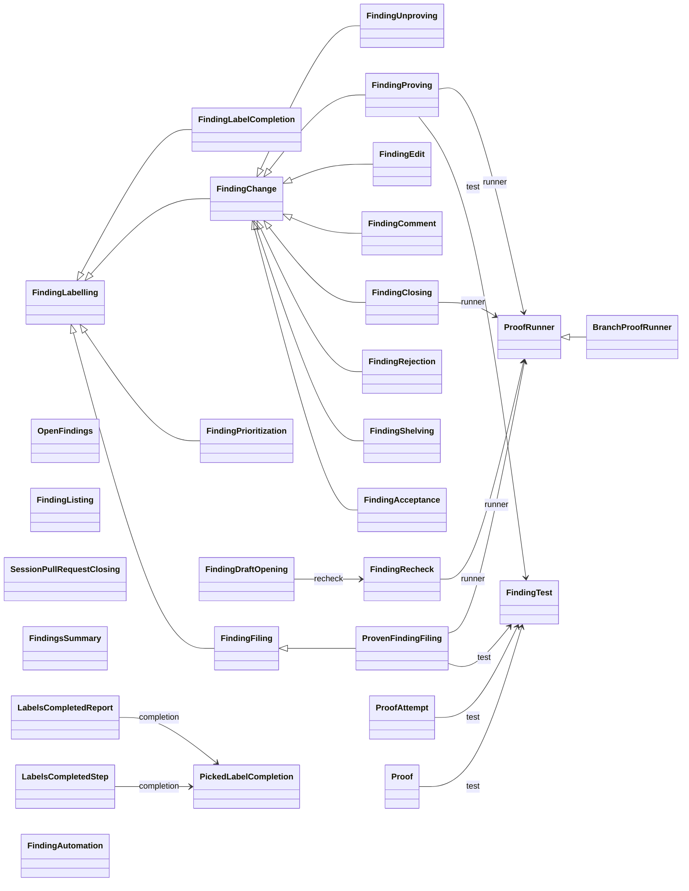
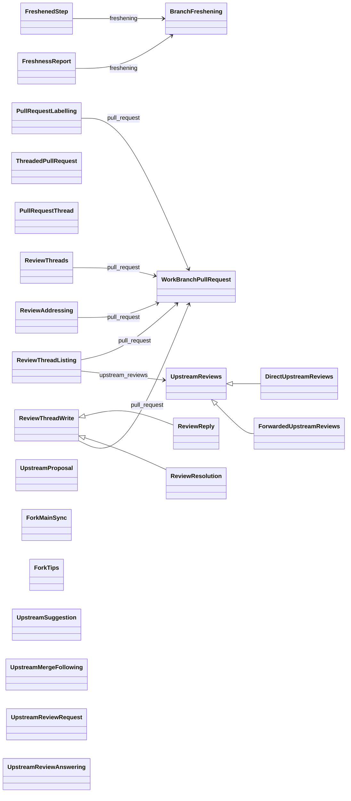
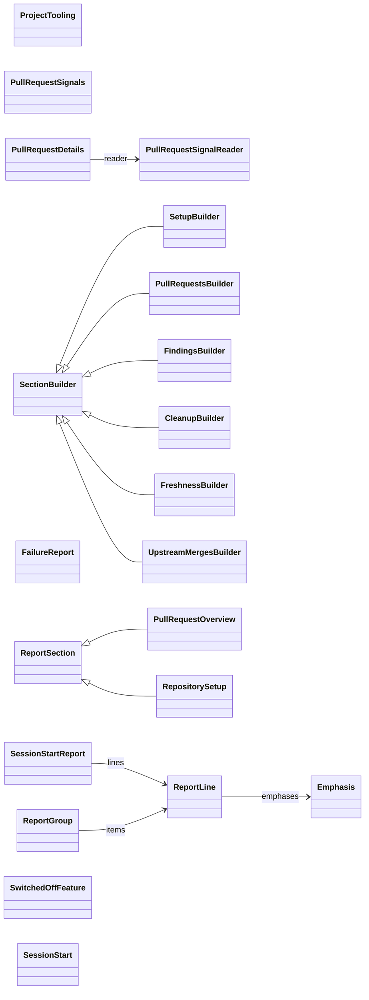
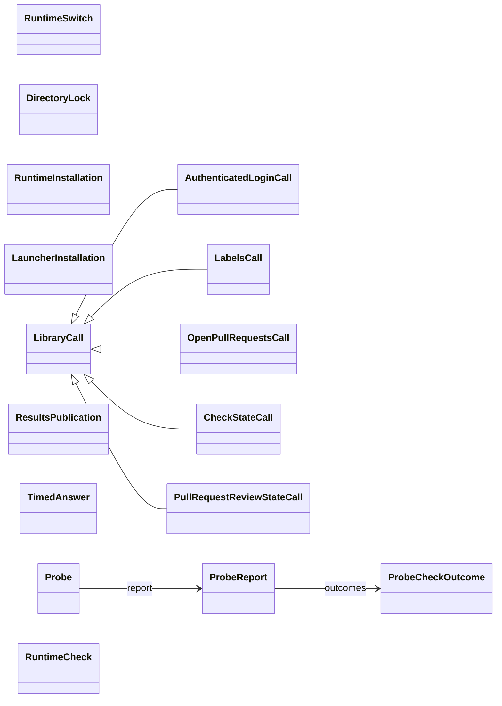
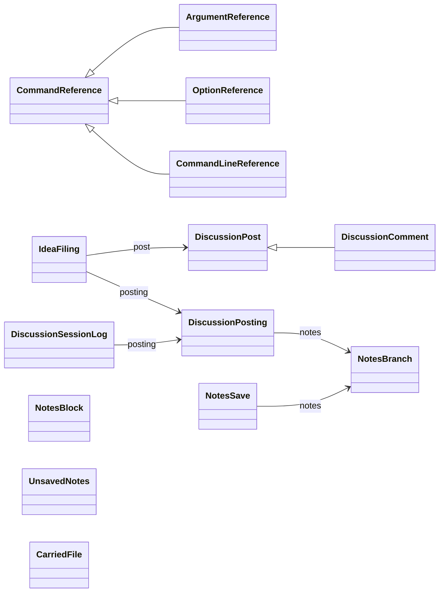
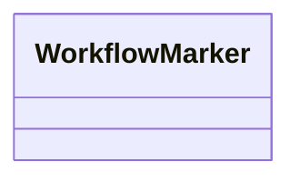

# GitHubWorkflow

A personal GitHub workflow for Claude Code sessions: standing notes and per-branch
progress every session starts with, and every write to git and GitHub made through the
workflow's own commands. It is built on the domain model of git and GitHub in
[`domain_model/`](domain_model), shipped with the plugin as a package of its own.

[TUTORIAL.md](TUTORIAL.md) walks through how the parts work together;
[REQUIREMENTS.md](REQUIREMENTS.md) says what the workflow has to do.

## Architecture

The diagrams in this section are drawn from the source by `github_workflow.architecture`:
the pre-commit hook draws them anew, and a test fails when they no longer match the
source. Never edit them by hand. The domain model's own are in its
[README](domain_model/README.md#architecture).

### Overview

The parts of the workflow, each a group of its modules, and the modules in none. An arrow from one node to another means the first imports the second; a node with
double side bars stands for a subpackage or a group of modules.

<!-- diagram: overview -->

<!-- end of diagram: overview -->

A hollow arrow points from a class to the class it extends, a plain arrow to a class
it holds in the field the arrow is labelled with. Enumerations and errors are left
out.

### Commands

The commands a session runs, their arguments, and what each builds from the session.

```mermaid
classDiagram
    direction LR
    class CommandAuthority
    class SessionRuns
    class SessionRunsOnOwnPullRequest
    class SessionRunsOnPersonsWord
    class PersonRuns
    class ValueCountParsing
    class CommandArgument
    class CommandSpecification
    class RefusalAdvice
    class CommandStep
    class FreshenedCommandStep
    class BranchStartStep
    class BranchSwitchStep
    class BranchDiscardStep
    class CommitStep
    class PushStep
    class DraftStep
    class SyncStep
    class StackOnStep
    class NotesSaveStep
    class DescribeStep
    class LabelStep
    class DetailsStep
    class FindingFileStep
    class FindingPrioritizeStep
    class FindingListStep
    class FindingAcceptStep
    class FindingShelveStep
    class FindingRejectStep
    class FindingCommentStep
    class FindingEditStep
    class FindingProveStep
    class FindingMarkUnprovenStep
    class FindingRecheckStep
    class FindingCloseStep
    class FindingAutomateStep
    class IdeaFileStep
    class CleanupStep
    class CloneStep
    class UpstreamStep
    class ReviewListStep
    class ReviewAddressedStep
    class ReviewReplyStep
    class ReviewResolveStep
    CommandAuthority <|-- SessionRuns
    CommandAuthority <|-- SessionRunsOnOwnPullRequest
    CommandAuthority <|-- SessionRunsOnPersonsWord
    CommandAuthority <|-- PersonRuns
    CommandStep <|-- FreshenedCommandStep
    CommandStep <|-- BranchStartStep
    CommandStep <|-- BranchSwitchStep
    CommandStep <|-- BranchDiscardStep
    CommandStep <|-- CommitStep
    FreshenedCommandStep <|-- PushStep
    FreshenedCommandStep <|-- DraftStep
    CommandStep <|-- SyncStep
    CommandStep <|-- StackOnStep
    CommandStep <|-- NotesSaveStep
    FreshenedCommandStep <|-- DescribeStep
    CommandStep <|-- LabelStep
    CommandStep <|-- DetailsStep
    CommandStep <|-- FindingFileStep
    CommandStep <|-- FindingPrioritizeStep
    CommandStep <|-- FindingListStep
    CommandStep <|-- FindingAcceptStep
    CommandStep <|-- FindingShelveStep
    CommandStep <|-- FindingRejectStep
    CommandStep <|-- FindingCommentStep
    CommandStep <|-- FindingEditStep
    CommandStep <|-- FindingProveStep
    CommandStep <|-- FindingMarkUnprovenStep
    CommandStep <|-- FindingRecheckStep
    CommandStep <|-- FindingCloseStep
    CommandStep <|-- FindingAutomateStep
    CommandStep <|-- IdeaFileStep
    CommandStep <|-- CleanupStep
    CommandStep <|-- CloneStep
    CommandStep <|-- UpstreamStep
    CommandStep <|-- ReviewListStep
    CommandStep <|-- ReviewAddressedStep
    CommandStep <|-- ReviewReplyStep
    CommandStep <|-- ReviewResolveStep
    CommandSpecification --> CommandAuthority : authority
    CommandSpecification --> CommandArgument : arguments
```

<!-- diagram: commands -->

<!-- end of diagram: commands -->

### Work

Branches, commits, pushes, drafts, sync and the cleanup of branches.

<!-- diagram: work -->

<!-- end of diagram: work -->

### Rules

The rules every write passes, and the guard judging every command a session runs.

<!-- diagram: rules -->

<!-- end of diagram: rules -->

### Findings

Findings, their proofs and their labels.

<!-- diagram: findings -->

<!-- end of diagram: findings -->

### Pull requests

The own pull request, forks, their upstream and following its reviews.

<!-- diagram: pull requests -->

<!-- end of diagram: pull requests -->

### Session start

The report a session starts with.

<!-- diagram: session start -->

<!-- end of diagram: session start -->

### Runtime

The runtime the plugin installs, and the probe of what a cloud session can reach.

<!-- diagram: runtime -->

<!-- end of diagram: runtime -->

### Notes

The notes branch, the Discussions posted through it and its Actions workflows.

<!-- diagram: notes -->

<!-- end of diagram: notes -->

### Shared

The files, environment variables, errors and markers every part names.

<!-- diagram: shared -->

<!-- end of diagram: shared -->

## Licence

This project is licensed under the [Apache License 2.0](LICENSE), except for
`domain_model/src/domain_model/exceptions.py` and
`domain_model/src/domain_model/class_property.py`, which contain code adapted
from [krrood](https://github.com/cram2/krrood) and remain under the GNU Lesser General
Public License, Version 3.

Part of the code and ideas are based on
[basstler](https://github.com/AbdelrhmanBassiouny/basstler) at commit
[`5b6e1b699d8ba69880e5ce15ad0b32c4764b0e60`](https://github.com/AbdelrhmanBassiouny/basstler/tree/5b6e1b699d8ba69880e5ce15ad0b32c4764b0e60),
and changed since. basstler is a personal project by Abdelrhman Bassiouny
(<bido.bassuny@gmail.com>), developed independently of any employer or institution. It is
licensed under the Apache License 2.0 as well; see [NOTICE](NOTICE) for attribution.
