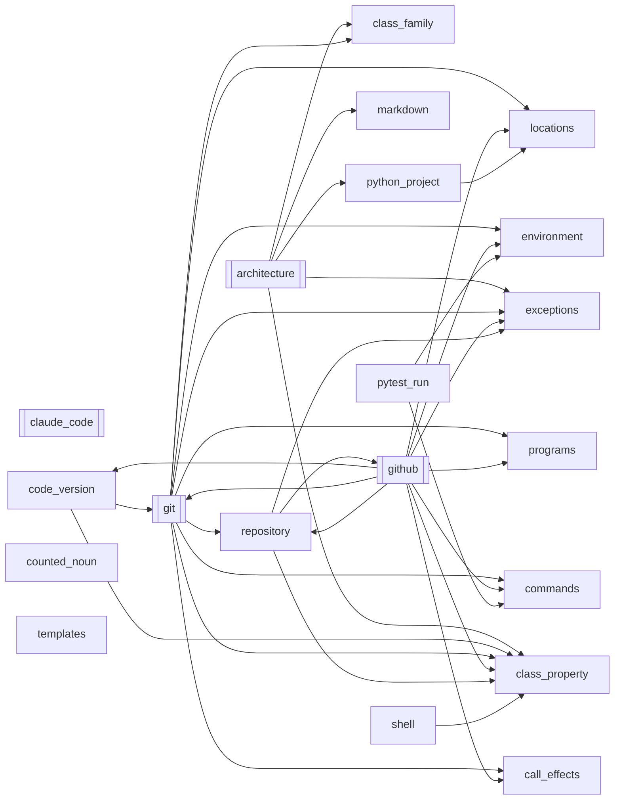
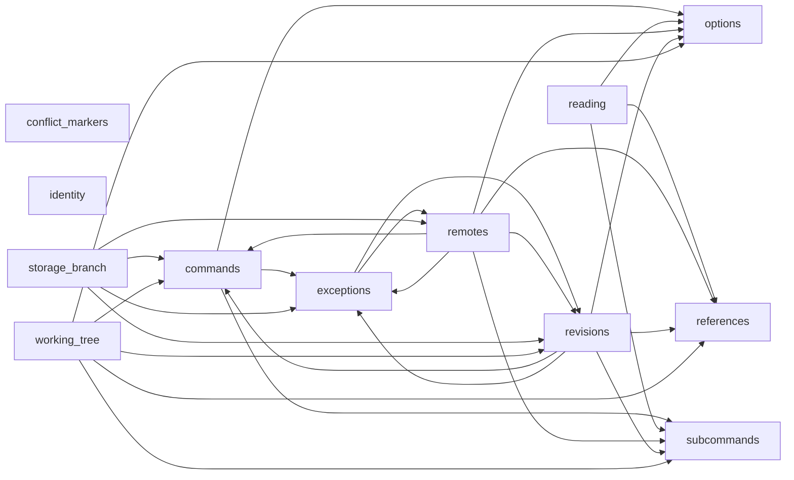
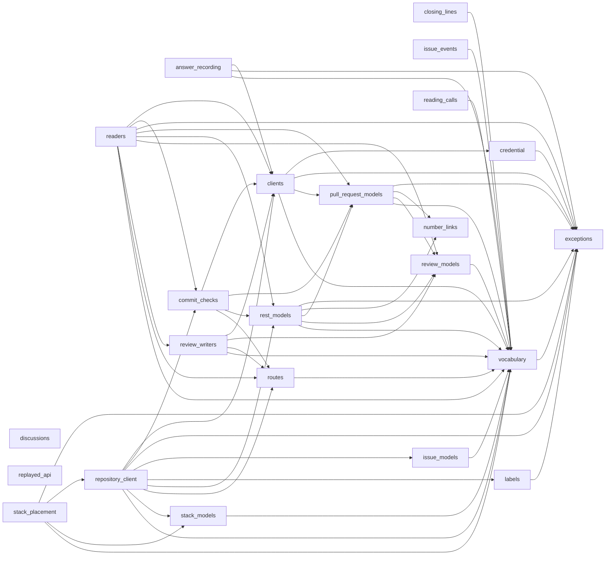
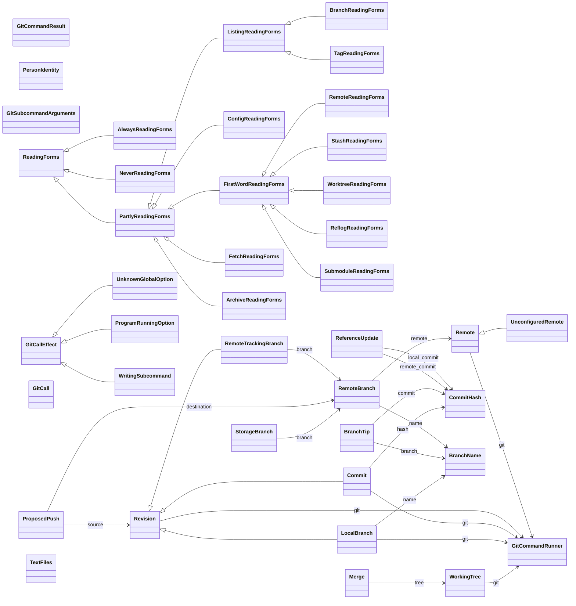
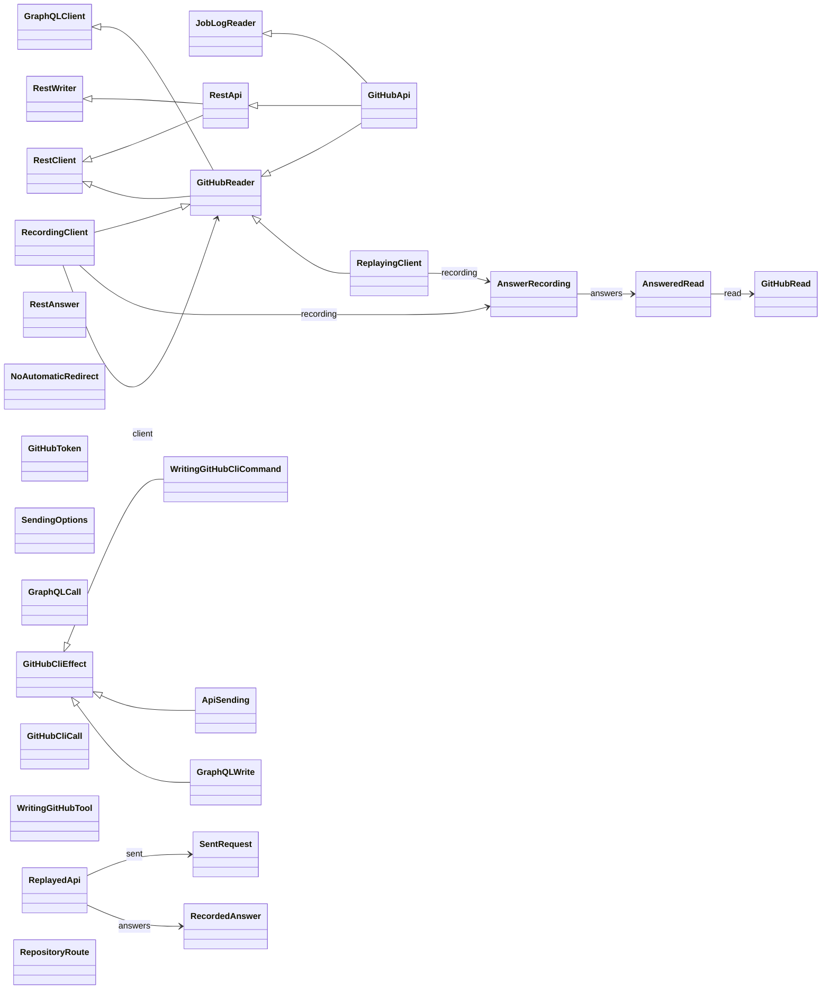
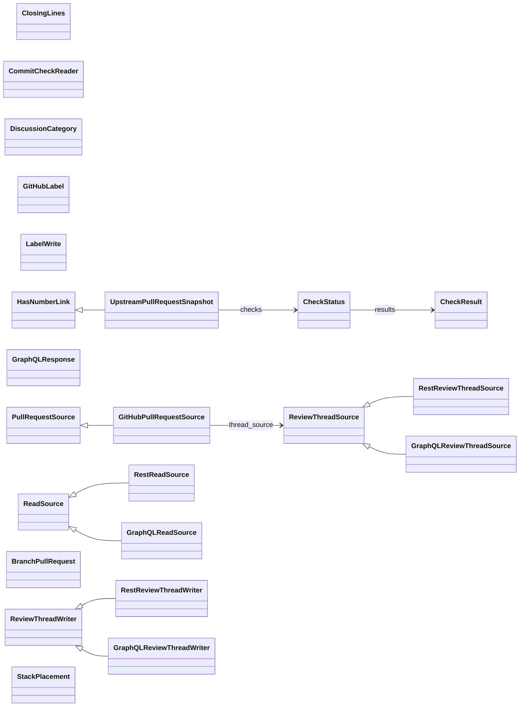
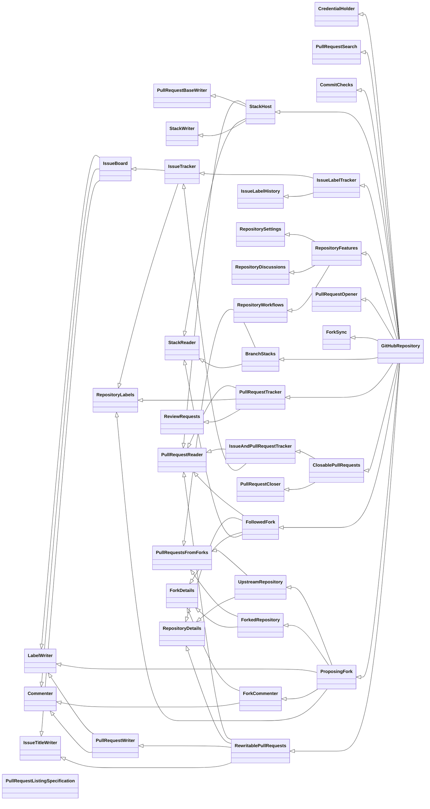

# github-workflow-domain-model

A deterministic, Python-native domain model of GitHub pull requests, checks, reviews and
labels, and of the git operations built around them.

## Architecture

The diagrams in this section are drawn from the source as `[tool.architecture-diagrams]`
in [pyproject.toml](pyproject.toml) declares them: the pre-commit hook draws them anew,
and a test fails when they no longer match the source. Never edit them by hand.

An arrow from one node to another means the first imports the second; a node with
double side bars stands for a subpackage or a group of modules.

### Overview

The subpackages and the top-level modules.

<!-- diagram: overview -->

<!-- end of diagram: overview -->

### Inside `git`

<!-- diagram: git modules -->

<!-- end of diagram: git modules -->

### Inside `github`

<!-- diagram: github modules -->

<!-- end of diagram: github modules -->

A hollow arrow points from a class to the class it extends, a plain arrow to a class
it holds in the field the arrow is labelled with. Enumerations and errors are left
out, and so are JSON models.

### Classes of `git`

<!-- diagram: git classes -->

<!-- end of diagram: git classes -->

### Classes of `github`

The classes calling GitHub's APIs, and recording and replaying their answers:

<!-- diagram: github client classes -->

<!-- end of diagram: github client classes -->

The classes reading and writing pull requests, reviews, checks and labels:

<!-- diagram: github reader classes -->

<!-- end of diagram: github reader classes -->

The classes of `repository_client`:

<!-- diagram: github repository classes -->

<!-- end of diagram: github repository classes -->

## Licence

This project is licensed under the [Apache License 2.0](LICENSE), except for
`src/domain_model/exceptions.py` and
`src/domain_model/class_property.py`, which contain code adapted from
[krrood](https://github.com/cram2/krrood) and remain under the GNU Lesser General
Public License, Version 3.

Part of the code and ideas are based on
[basstler](https://github.com/AbdelrhmanBassiouny/basstler) at commit
[`5b6e1b699d8ba69880e5ce15ad0b32c4764b0e60`](https://github.com/AbdelrhmanBassiouny/basstler/tree/5b6e1b699d8ba69880e5ce15ad0b32c4764b0e60),
and changed since. basstler is a personal project by Abdelrhman Bassiouny
(<bido.bassuny@gmail.com>), developed independently of any employer or institution. It is
licensed under the Apache License 2.0 as well; see [NOTICE](NOTICE) for attribution.
